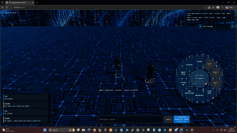
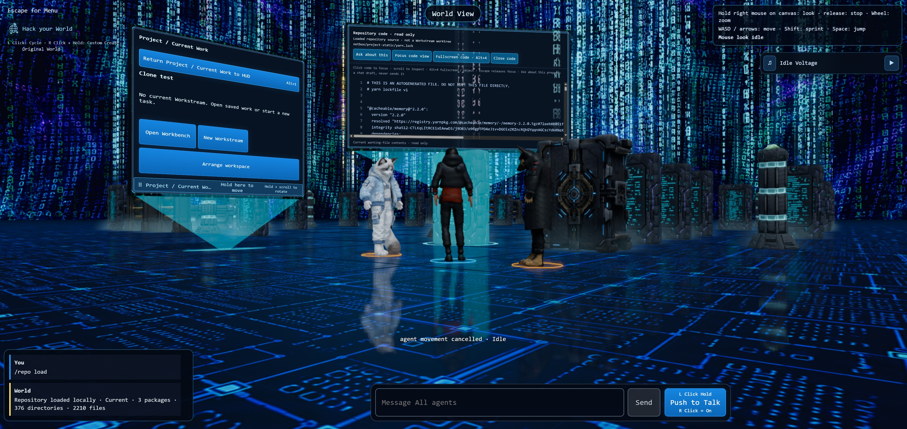
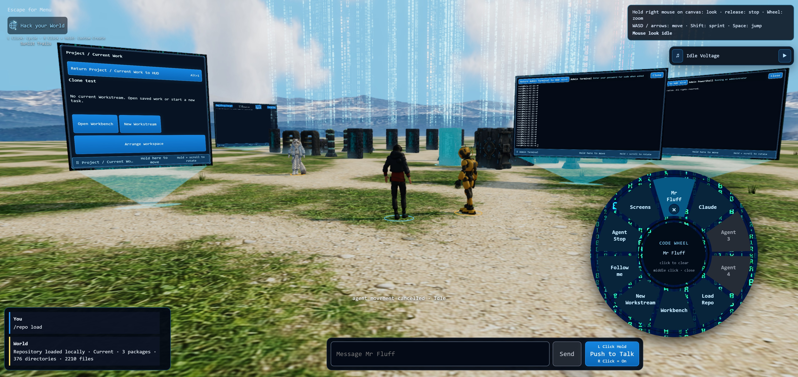
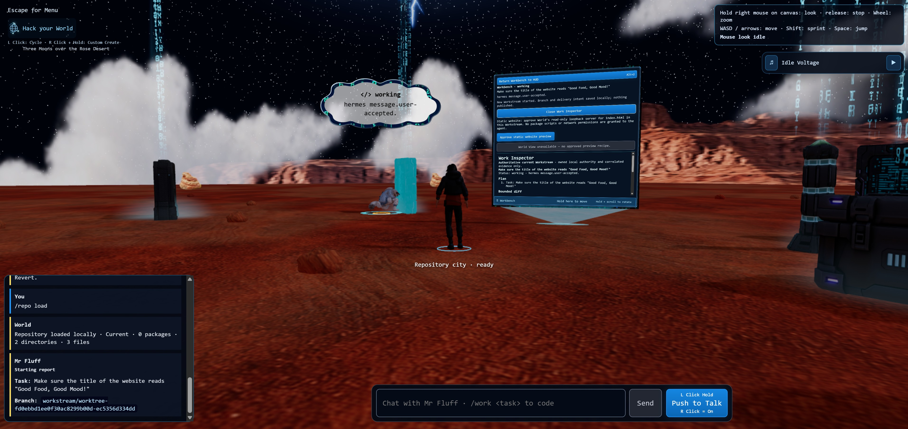
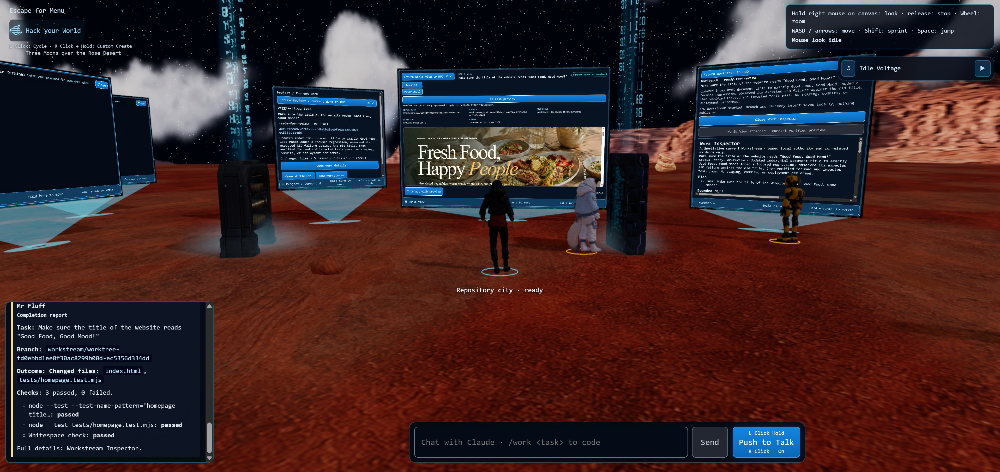

# AgentIntersect World

**Your code becomes a place. Your agents become a presence.**

A local-first 3D workspace for your repositories and your own AI coding agents. Explore a repository as a city, discuss ideas with **Claude Code, Codex, Hermes or OpenClaw**, give work its own branch, and inspect the changes and previews—all in one World.

[Download World](https://agentintersect.com/download/) · [Watch the launch reel (~100s)](https://github.com/MelaBuilt-AI/AgentIntersect-World/releases/download/launch-demos/launch-reel.mp4) · [Field Guide](https://guide.agentintersect.com/getting-started/) · [Release notes](https://github.com/MelaBuilt-AI/AgentIntersect-World/releases/latest) · [Discord](https://discord.gg/8GfKXaJsyY)

> **Public preview** for Windows x64 and Linux x64 (glibc). There is no macOS build. Windows builds are unsigned. Bring an installed, signed-in agent harness; model accounts and subscriptions are separate.



<p align="center">
  <a href="docs/launch/media/world-1.jpg"></a>
  <a href="docs/launch/media/world-2.jpg"></a>
  <a href="docs/launch/media/world-3.jpg"></a>
  <a href="docs/launch/media/world-4.jpg"></a>
</p>

_Development capture: World load → repository city ready. [More demos below](#demos)._

## Why World

Your coding agents already work well in a terminal. World is for when you want to see the work: your repository as a place you can walk, up to four of your own agents side by side, and each piece of work on its own branch with its diffs, validation results and preview in one view instead of spread across windows.

It is not another hosted chat IDE and not a replacement for your agents. You keep the harnesses, logins and model plans you already use; World gives them a shared place to work.

## What you can do

- **Explore your code spatially.** Load or create a repository and navigate its code city.
- **Bring your own agents.** Choose saved native connections and a constellation of up to four agents, each with its own identity and avatar.
- **Turn conversation into work.** Create a Workstream, inspect source and diffs, read validation results, and open an approved World View preview.
- **Keep tools within reach.** Use the Code Wheel, HUD or spatial screens, with explicit Terminal and PowerShell controls.
- **Make the environment yours.** Describe a custom World, tune weather and scenery, and save it for later.

World is built for one operator working locally—not a public multiplayer service, a hosted model subscription, or a replacement for your native agent harness. Local-first does not mean model-offline: your chosen harness may use cloud services. Do not expose the backend to the internet.

## Quick start

1. **Have one agent ready.** Install and sign in to Claude Code, Codex, Hermes or OpenClaw in its own app. World does not log in for you.
2. **Install World** for your platform from the [download page](https://agentintersect.com/download/) (details [below](#install-world)).
3. **Connect your agent.** On first launch, **Agent Setup Menu** opens. Choose **Discover Agents**, pick your agent's native identity, then **Attach to Agent Intersect World**.
4. **Enter World.** Continue to **Agent Select**, choose who joins and pick avatars.
5. **Load a repository** and walk its city, then ask your agents for work.

The [Field Guide](https://guide.agentintersect.com/getting-started/) walks through each step, and [Troubleshooting](https://guide.agentintersect.com/troubleshooting/) covers common setup problems.

## Install World

Download from the [download page](https://agentintersect.com/download/) or the [latest release](https://github.com/MelaBuilt-AI/AgentIntersect-World/releases/latest), and compare each file's SHA-256 with the release's `SHA256SUMS`.

- **Windows x64:** run the setup installer, or use the portable ZIP. Node and Git are included. **The installer is unsigned**; follow your device's security policy rather than turning protections off.
- **Debian / Ubuntu x64:** `sudo apt install ./AgentIntersect-World-*-linux-x64.deb`, then run `agentintersect-world`.
- **Other glibc Linux x64:** unpack the portable archive and run its `agentintersect-world` launcher. Git is required; Node is bundled.
- **Linux terminal installer** (needs Node 20+): `npx -y @agentintersect-world/installer@rc install` downloads the release archive and checks its SHA-256 before installing.
- **macOS:** not supported. World runs on Windows and Linux only for now.

This is a public preview, so back up your projects and World data. To update, close World and run `agentintersect-world update --check`, then `agentintersect-world update`; updates verify the release files and keep your saved state.

Running agents across Windows and WSL also needs native Python 3 in the target environment and a shared drive-backed World data directory. Upgrade notes, custom XDG roots, exact checksums and source provenance are in the [release details](docs/PUBLIC_RELEASE_0.15.0-rc.4.md).

## Connect your agents

**Agent Setup Menu** opens on first launch, and **Escape for Menu** reopens it later without wiping saved work.

- **Discover Agents** only reads install and identity metadata. It does not log in, change providers, install plugins or start WSL distros.
- Any change to an agent's native profile (for example, enabling the bundled Hermes plugin) is previewed first and applied only after you approve that specific change. Hermes API setup can replace the key other clients use, so check the result before approving it again after an error.
- OpenClaw needs its own authenticated native gateway; set it up and sign in through OpenClaw itself.
- World never restarts your gateways or services for you, and does **not** collect harness logins. Finish sign-in in each harness's own app.
- After attaching, confirm a normal greeting and a harmless tool-backed task work. Discovery alone is not readiness.

Step by step: [Agent setup in the Field Guide](https://guide.agentintersect.com/agent-setup/) · Hermes service restarts: [release details](docs/PUBLIC_RELEASE_0.15.0-rc.4.md#connect-your-agents)

## Demos

Development captures; these demonstrate the product, not every control in the current release. Full MP4s are on the [launch-demos](https://github.com/MelaBuilt-AI/AgentIntersect-World/releases/tag/launch-demos) release (GitHub's file viewer often won't play repo videos, so use the download links):

| Demo                                   | Watch / download                                                                                                         |
| -------------------------------------- | ------------------------------------------------------------------------------------------------------------------------ |
| **Launch reel** (city + coding, ~100s) | [launch-reel.mp4](https://github.com/MelaBuilt-AI/AgentIntersect-World/releases/download/launch-demos/launch-reel.mp4)   |
| Repo city / `/repo load`               | [repo-city.mp4](https://github.com/MelaBuilt-AI/AgentIntersect-World/releases/download/launch-demos/repo-city.mp4)       |
| Agent coding / embodiment              | [agent-coding.mp4](https://github.com/MelaBuilt-AI/AgentIntersect-World/releases/download/launch-demos/agent-coding.mp4) |

## Hack your World

**Describe the place you want to work in.** Hack your World changes the cosmetic environment around your agents and repository: ground, skies, scenery, weather, lightning and ambience. Your code, repository authority and movement rules stay unchanged.

Left-click the sparking globe beneath **Escape for Menu** to cycle presets, or hold right-click on it to describe your own World and have a connected agent build it. Preview, then save it to one of eight custom slots or revert.

Try: “A rocky storm world with large branching lightning overhead and small, frequent distant bolts just above the mountain ridges, with soft surrounding flashes.”

**Walkthrough:** [Hack your World Field Guide](https://guide.agentintersect.com/hack-your-world/) · [Feature details and generation limits](docs/HACK_YOUR_WORLD.md)

## Develop from source

Requires **Node.js 24.x**, Corepack and Git. Use an HTTPS clone for public access:

```sh
git clone https://github.com/MelaBuilt-AI/AgentIntersect-World.git
cd AgentIntersect-World
corepack pnpm@11.15.0 install --frozen-lockfile
corepack pnpm@11.15.0 dev
```

Open the Vite URL (normally `http://127.0.0.1:5173`). Backend defaults to loopback port `3770`.

### Run checks

```sh
corepack pnpm@11.15.0 test
corepack pnpm@11.15.0 typecheck
corepack pnpm@11.15.0 lint
```

See [docs/launch/README.developer.md](docs/launch/README.developer.md) for the longer agent-setup and acceptance notes, and [docs/AGENT_SETUP_MENU.md](docs/AGENT_SETUP_MENU.md) for the Agent Setup design.

Historical engineering phase notes and proof kits live under [docs/internal/](docs/internal/) (not required for using or building World).

## Follow releases

To follow future releases, select **Watch → Custom → Releases** on this repository. A GitHub account is required; delivery follows your notification settings. No mailing-list signup is needed.

If World is useful to you, a star on this repository helps other developers find it.

## Community and support

- [Website and downloads](https://agentintersect.com/download/) · [Field Guide](https://guide.agentintersect.com/getting-started/)
- [Report an issue](https://github.com/MelaBuilt-AI/AgentIntersect-World/issues) · [Private security reporting](SECURITY.md)
- [Contributing](CONTRIBUTING.md) · [Third-party and asset notices](THIRD_PARTY_NOTICES.md)
- [MelaBuilt AI](https://melabuilt.ai) · [X / @melabuiltai](https://x.com/melabuiltai) · [Discord](https://discord.gg/8GfKXaJsyY)

When reporting a problem, include the release, operating system, failed action and exact error. Remove credentials, private conversations and sensitive paths.

## License

World-owned code is [MIT licensed](LICENSE) © MelaBuilt AI. Bundled dependencies and supplied artwork retain their own terms; see [third-party notices](THIRD_PARTY_NOTICES.md) and the [release’s corresponding-source material](docs/PUBLIC_RELEASE_0.15.0-rc.4.md#exact-accepted-artifacts).
