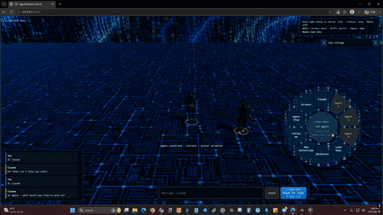

# AgentIntersect World

**Your code becomes a place. Your agents become a presence.**

Local-first 3D workspace where your own coding agents (Claude Code, Codex, Hermes, OpenClaw, and friends) work on your repository as a world you can walk — not another hosted chat IDE, and not a replacement for those agents.

> **Public preview · 0.15.0-rc.2:** [Download for Windows or Linux](https://agentintersect.com/download/) · [Release notes & checksums](https://github.com/MelaBuilt-AI/AgentIntersect-World/releases/tag/v0.15.0-rc.2) · [Field Guide](https://guide.agentintersect.com/getting-started/). Windows builds are unsigned.



_GIF: world load → repository city ready (~26s). Full clips linked below._

## Demos

In-development captures.

Inline GIF above shows the repo-city load. Full MP4s are on the [launch-demos](https://github.com/MelaBuilt-AI/AgentIntersect-World/releases/tag/launch-demos) prerelease (GitHub’s file viewer often won’t play repo videos — use the download links):

| Demo                                   | Watch / download                                                                                                         |
| -------------------------------------- | ------------------------------------------------------------------------------------------------------------------------ |
| **Launch reel** (city + coding, ~100s) | [launch-reel.mp4](https://github.com/MelaBuilt-AI/AgentIntersect-World/releases/download/launch-demos/launch-reel.mp4)   |
| Repo city / `/repo load`               | [repo-city.mp4](https://github.com/MelaBuilt-AI/AgentIntersect-World/releases/download/launch-demos/repo-city.mp4)       |
| Agent coding / embodiment              | [agent-coding.mp4](https://github.com/MelaBuilt-AI/AgentIntersect-World/releases/download/launch-demos/agent-coding.mp4) |

## Get notified

No email capture. Use GitHub:

1. Open [MelaBuilt-AI/AgentIntersect-World](https://github.com/MelaBuilt-AI/AgentIntersect-World)
2. **Watch** → **Custom** → check **Releases** → Apply

This subscribes you to new [Releases](https://github.com/MelaBuilt-AI/AgentIntersect-World/releases), rather than every commit. A GitHub account is required; delivery follows your GitHub notification settings. Publishing a tag or pushing code is not the packaged-release announcement. The product site links here for the same path: [Watch on GitHub for release notifications](https://agentintersect.com).

## What it is

- **Repository-as-landscape** — intake a repo and explore it as a spatial world (the “repo city”).
- **BYO agents** — attach harnesses you already run locally; World does not log in as you or replace Claude Code / Codex.
- **Conversation → Workstream → World View** — talk, assign work, then see agents as presence in the world.
- **Local loopback** — built for one operator on your machine, not a multi-user internet service.

## Hack your World

**Describe the place you want to work in.** Hack your World changes the cosmetic environment around your agents and repository: ground, layered skies, distant scenery, weather, lightning and ambience. Your code, repository authority and movement rules stay unchanged.

1. **Try a preset:** left-click the sparking globe beneath **Escape for Menu** to cycle Original World → Sunlit Trails → Martian Expanse → saved custom Worlds. Original is the initial default.
2. **Describe your own:** hold right-click on the globe, or focus it and press **Shift+F10**. Enter 1–500 words; in a multi-agent World, choose the **World designer**. Only **Create with connected agent** sends the request, in a separate restricted recipe turn—not your coding conversation. Your harness's existing model/usage plan still applies.
3. **Tune the atmosphere:** expand **Weather and expanded scenery** to choose weather particles, ground, horizon, decorative cutouts, ambience and upper/local lightning. **Distant horizon lightning** adds a separate band of small flashes near the mountain ridges. Leave controls **From description** for the agent to choose, or pin your choices. **Preview these settings** needs no agent call.
4. **Keep or revert:** after preview, choose **Save to Custom**, **Use without saving**, or **Revert**. Eight numbered custom slots belong to this World install, survive refresh, and join globe cycling. Replacing or removing an occupied slot requires confirmation; temporary previews are not saved slots.

**Retrieve your original prompt:** in the custom dialog, expand **View description — Current World**, or open **Custom slots on this PC → View description — Custom N**, then **Copy description**. Newly created saved Worlds retain the exact submitted description; older slots without it show an unavailable message rather than inventing a prompt. All transient Hack notifications clear after five seconds; active progress and save/revert choices remain until resolved.

Try: “A rocky storm world with large branching lightning overhead and small, frequent distant bolts just above the mountain ridges, with soft surrounding flashes.”

Cancellation or failed generation/loading keeps the previous usable World. Effects mute controls weather audio separately from music; Reduced Motion skips animated weather and interference. The optional advanced recipe editor accepts validated visual JSON, not executable code or arbitrary asset URLs. Supplied scenery is bounded; decorative cutouts are 2D artwork, not physical terrain or weather simulation.

**Walkthrough:** [Hack your World Field Guide](https://guide.agentintersect.com/hack-your-world/) · [Feature details and supported generation limits](docs/HACK_YOUR_WORLD.md) · [Asset notices](THIRD_PARTY_NOTICES.md)

## What this is not

- Not Cursor / Windsurf (editor replacement)
- Not a hosted agent product (you bring local agents)
- Not unrelated “Intersect AI” products — this is **AgentIntersect World** by [MelaBuilt AI](https://melabuilt.ai)

## Install World

**Windows x64:** download the [setup installer](https://github.com/MelaBuilt-AI/AgentIntersect-World/releases/download/v0.15.0-rc.2/AgentIntersect-World-0.15.0-rc.2-windows.3-windows-x64-setup.exe), compare its SHA-256 with the release manifest, run setup, then launch **AgentIntersect World**. A private Node runtime and Git are included. **This installer is unsigned**; follow your device’s security policy rather than disabling protections. A portable ZIP is also available on the release page.

**Debian / Ubuntu x64:** download the `.deb` from the [release](https://github.com/MelaBuilt-AI/AgentIntersect-World/releases/tag/v0.15.0-rc.2), then:

```sh
sudo apt install ./AgentIntersect-World-0.15.0-rc.2-linux-x64.deb
agentintersect-world
```

**Other glibc-based Linux x64:** use the portable `linux-x64.tar.gz` and run its `agentintersect-world` launcher. Git is required; the application bundles Node.

**Optional Linux terminal installer** (requires Node 20+ for the bootstrap):

```sh
npx -y @agentintersect-world/installer@0.15.0-rc.2 install
~/.local/bin/agentintersect-world
```

The installer downloads the exact release archive and checks its SHA-256 before installation. It prints your installed launcher path; custom XDG roots may change that path. The npm package uses the **rc** channel, not a stable-release promise.

At least one supported harness must be installed and authenticated separately. Model accounts, subscriptions and optional voice setup are not included. This release is a public preview: back up projects and application data. Earlier private kits reused this version label; check exact hashes and preserve existing state rather than assuming same-version installation upgrades older private bytes.

See [public release details](docs/PUBLIC_RELEASE_0.15.0-rc.2.md) for source provenance, checksums, source material and known limitations. Windows/WSL cross-environment execution additionally needs native Python 3 in the target environment and a shared drive-backed World data directory.

## Develop from source

Requires **Node.js 24+**, Corepack and Git. Use an HTTPS clone for public access:

```sh
git clone https://github.com/MelaBuilt-AI/AgentIntersect-World.git
cd AgentIntersect-World
```

```sh
corepack pnpm@11.15.0 install --frozen-lockfile
corepack pnpm@11.15.0 dev
```

Open the Vite URL (normally `http://127.0.0.1:5173`). Backend defaults to loopback port `3770`.

## Connect your agents

1. After the opening logo, a new install opens **Agent Setup Menu**.
2. **Discover Agents** — reads install / native identity metadata. It does not log in, change providers, install plugins, or start WSL distros for you.
3. Pick harness + **native identity**, name the World connection, then **Attach to Agent Intersect World**.
4. **Continue to Agent Select**, choose who joins this World, set avatars when asked.

Later launches skip completed setup. **Escape for Menu** reopens Agent Setup without wiping saved work.

World does **not** collect harness login credentials in the browser. Finish auth in each harness’s own app.

Deep dive: [docs/AGENT_SETUP_MENU.md](docs/AGENT_SETUP_MENU.md) · full developer README preserved at [docs/launch/README.developer.md](docs/launch/README.developer.md)

## Links

- Product: https://agentintersect.com
- Field Guide: https://guide.agentintersect.com
- Melabuilt: https://melabuilt.ai
- X: [@melabuiltai](https://x.com/melabuiltai)
- Community: [Discord](https://discord.gg/8GfKXaJsyY)
- [Contributing](CONTRIBUTING.md) · [Private security reporting](SECURITY.md)
- [Third-party and asset notices](THIRD_PARTY_NOTICES.md)
- Launch drafts: [docs/launch/](docs/launch/)

## License

[MIT](LICENSE) © MelaBuilt AI

## Development

```sh
corepack pnpm@11.15.0 test
corepack pnpm@11.15.0 typecheck
corepack pnpm@11.15.0 lint
```

See [docs/launch/README.developer.md](docs/launch/README.developer.md) for the longer agent-setup and acceptance notes.

Historical engineering phase notes and proof kits live under [docs/internal/](docs/internal/) (not required for using or building World).
